# Borod Bank — Production-Grade GitOps/AIOps Platform

[](https://kubernetes.io/)
[](https://www.terraform.io/)
[](https://www.jenkins.io/)
[](https://argo-cd.readthedocs.io/)
[](https://spring.io/projects/spring-boot)
[](https://aws.amazon.com/eks/)
[](LICENSE)

A fully automated **GitOps/AIOps platform** built on AWS EKS, featuring a three-tier CI/CD pipeline, AI-powered code review, canary deployments with auto-rollback, and comprehensive observability. Designed and operated as a **one-person DevOps project** to demonstrate production-grade infrastructure patterns.

---

## Architecture Overview

```
┌──────────────────────────────────────────────────────────────────────────────┐
│                     BOROD BANK — GITOPS / AIOPS PLATFORM                     │
│                                                                              │
│  Developer                                                                   │
│     │                                                                        │
│     ▼                                                                        │
│  GitHub PR ──► GitHub Actions (lint, test, security)                         │
│     │                                                                        │
│     ▼ merge                                                                  │
│  Jenkins CI (20+ stages)                                                     │
│     │  Gitleaks → Hadolint → Trivy → Compile → Test → SonarQube              │
│     │  → Build → SBOM → Cosign Sign → Push Image → Update CD repo            │
│     │                                                                        │
│     ▼                                                                        │
│  ArgoCD (App of Apps — 18 managed apps)                                      │
│     │  Auto-sync ──► Argo Rollouts (canary 10%→50%→100%)                     │
│     │                    │                                                   │
│     │                    ▼                                                   │
│     │             Prometheus AnalysisTemplate                                │
│     │             (auto-rollback if error rate > 5%)                         │
│     │                                                                        │
│     ▼                                                                        │
│  AWS EKS (Kubernetes 1.32)                                                   │
│     ├── Spring Boot App (Argo Rollouts, HPA 2-6 replicas)                    │
│     ├── RDS MySQL 8.4 (encrypted, 7-day backups)                             │
│     ├── Jenkins Controller + Ephemeral Pod Agents                            │
│     ├── SonarQube (persistent, gp2-csi)                                      │
│     ├── Prometheus + Grafana (5 dashboards)                                  │
│     ├── Kyverno (3 policies) + Cosign Verification                           │
│     ├── Chaos Mesh (pod-kill, network-delay, stress-cpu)                     │
│     ├── External Secrets Operator → AWS Secrets Manager                      │
│     └── AIOps: Claude API + FastAPI gateway (automated code review)          │
│                                                                              │
│  Nightly Pipeline (14 stages, 2 AM daily)                                    │
│     PIT Mutation → ArchUnit → k6 Perf → ZAP DAST → Nuclei → AI Review        │
│     → 17 metrics → Pushgateway → Prometheus → Grafana                        │
│                                                                              │
│  Monitoring: Prometheus + Grafana + Slack Notifications                      │
└──────────────────────────────────────────────────────────────────────────────┘
```

---

## Screenshots

### Application

| Login Page | Dashboard | Transactions |
|:---:|:---:|:---:|
| 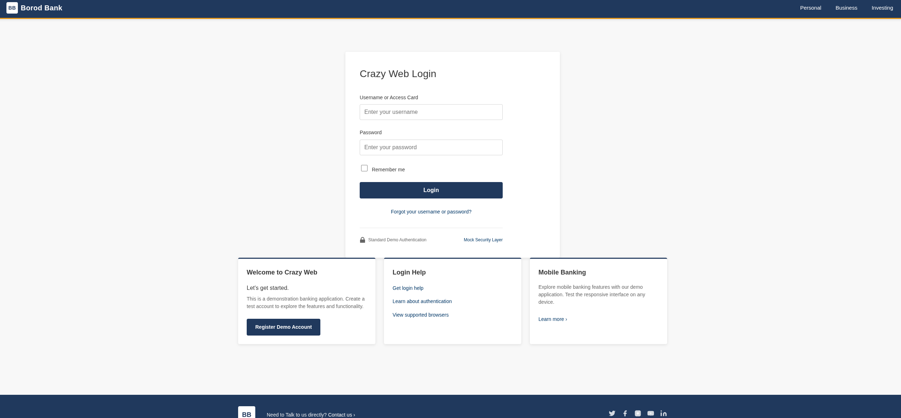 | 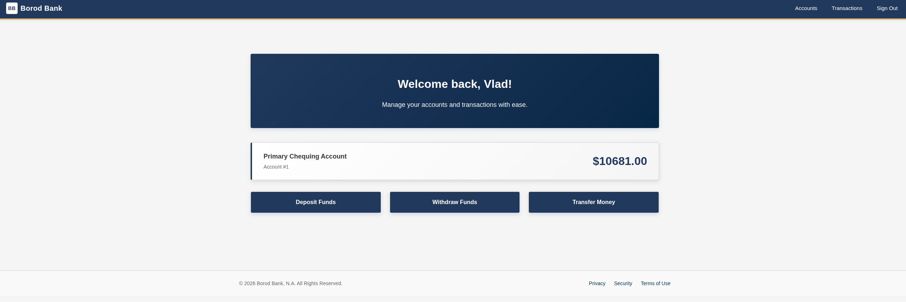 | 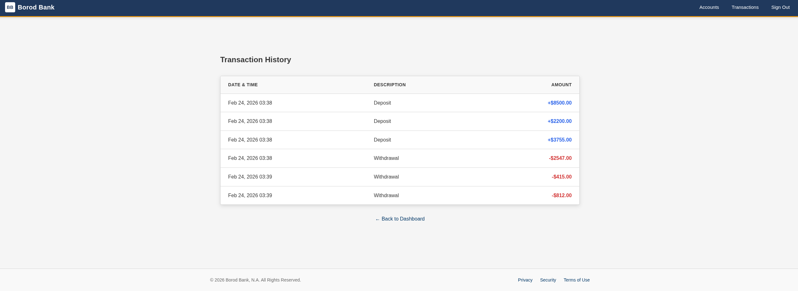 |

### Jenkins CI Pipeline — 20+ Stages

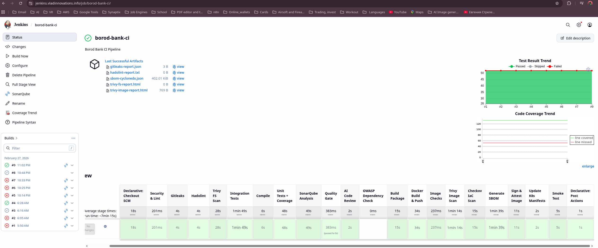

### Jenkins Nightly Pipeline — 14 Stages

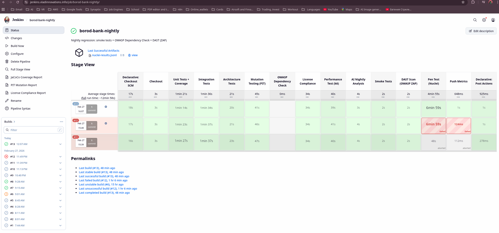

### ArgoCD — 18 Managed Applications

| App of Apps | Application Details |
|:---:|:---:|
| 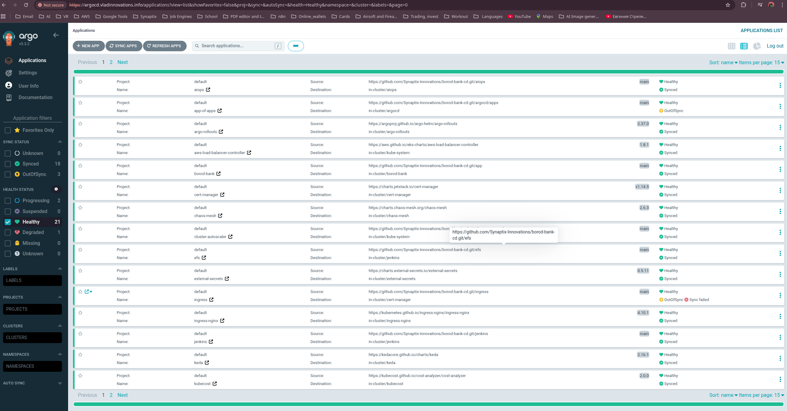 | 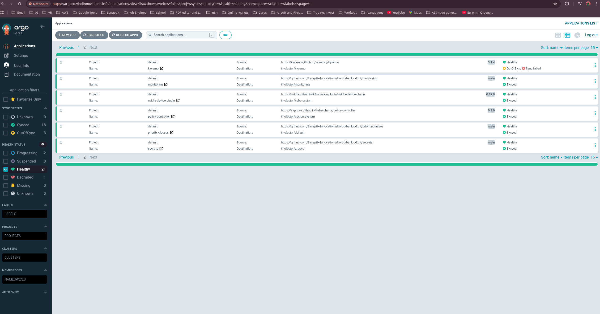 |

### Grafana Dashboards

| Infrastructure & Kubernetes | Nightly Pipeline Metrics |
|:---:|:---:|
| 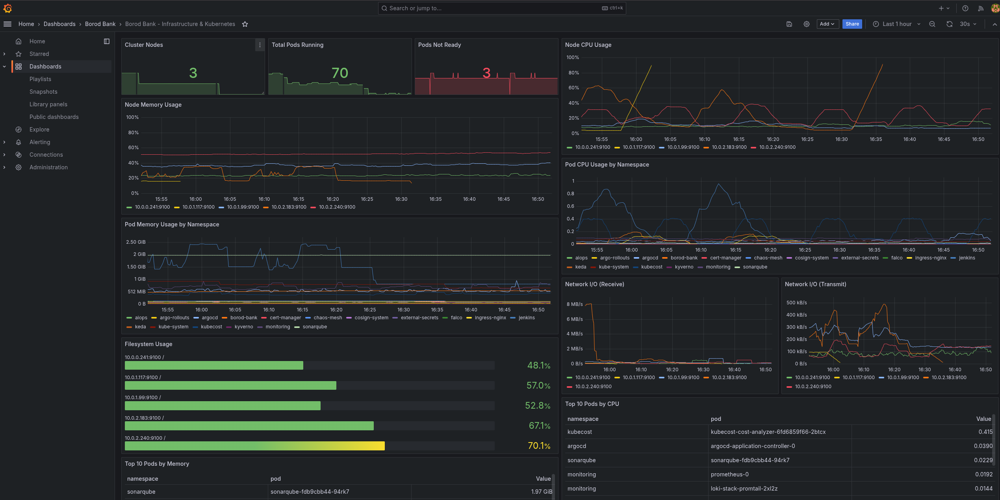 | 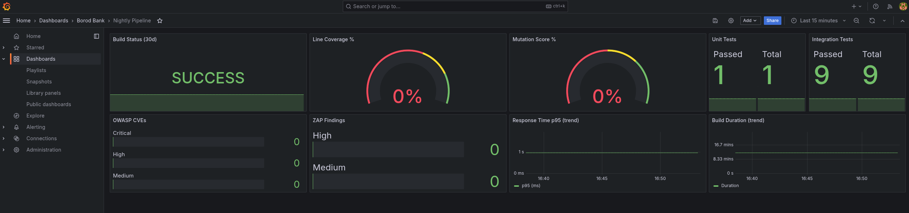 |

| Application Overview | AIOps Code Review |
|:---:|:---:|
| 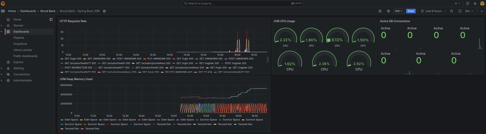 | 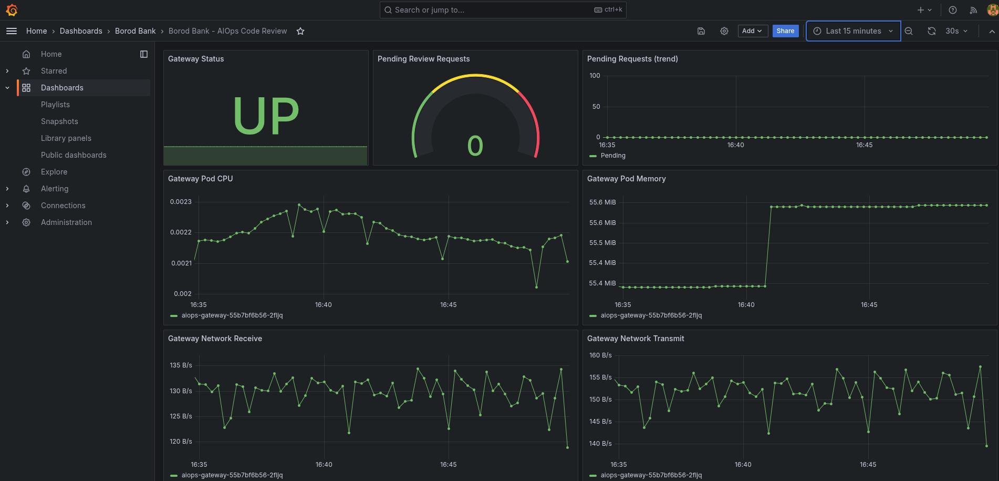 |

### Slack Notifications

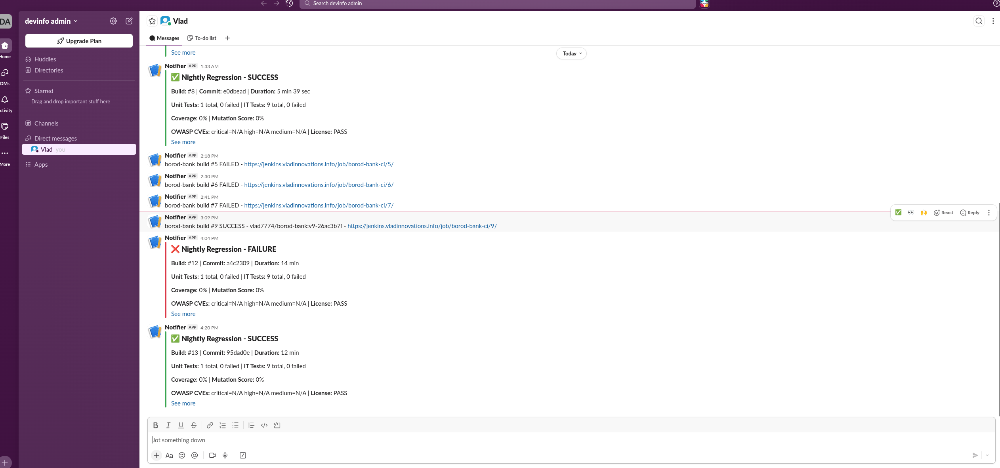

### AWS Infrastructure

| EC2 Instances & ASG | EKS Cluster |
|:---:|:---:|
| 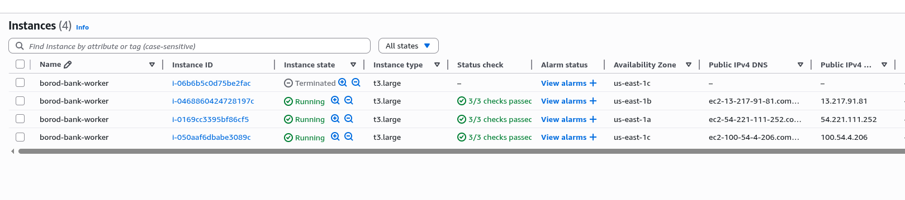 | 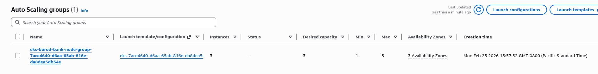 |

---

## Key Features

- **Three-Tier CI/CD** — GitHub Actions (PR gate, 5 jobs) → Jenkins CI (20+ stages) → Jenkins Nightly (14-stage deep analysis)
- **Full GitOps with ArgoCD App of Apps** — 18 applications managed declaratively, auto-synced from Git
- **Jenkins CI: 20+ stage pipeline** — Gitleaks, Hadolint, Trivy (FS + image), SonarQube, Checkov, SBOM (Syft), Cosign signing
- **Nightly Regression: 14 stages** — PIT mutation testing, ArchUnit architecture tests, k6 performance, ZAP DAST, Nuclei pen testing, AI-powered code review
- **Canary Deployments** — Argo Rollouts with Prometheus-based AnalysisTemplate, auto-rollback on >5% error rate
- **Monitoring Stack** — Prometheus + Grafana with 5 provisioned dashboards and 17 nightly pipeline metrics via Pushgateway
- **AIOps Code Review** — Claude API (Haiku) + FastAPI gateway, automated nightly analysis with Slack reporting
- **Chaos Engineering** — Chaos Mesh experiments: pod-kill, network-delay, stress-cpu
- **Policy Enforcement** — Kyverno policies: require resource limits, disallow latest tag, require read-only root filesystem
- **Supply Chain Security** — Cosign image signing, SBOM generation with Syft, ClusterImagePolicy verification
- **Secret Management** — External Secrets Operator syncing from AWS Secrets Manager (zero hardcoded secrets)
- **Infrastructure as Code** — Terraform managing VPC, EKS, RDS, KMS, EFS, IRSA roles, VPC flow logs

---

## AIOps — AI-Powered Code Review

```
┌──────────────────────────────────────────────────────────────────────┐
│                        AIOps Architecture                            │
│                                                                      │
│  Nightly Pipeline (Jenkins)                                          │
│    │                                                                 │
│    ▼                                                                 │
│  AI Nightly Analysis stage                                           │
│    │  sends code diff + metrics                                      │
│    ▼                                                                 │
│  FastAPI Gateway (K8s pod)                                           │
│    │  routes request to Claude API                                   │
│    ▼                                                                 │
│  Claude API (Haiku) ──► code review + recommendations                │
│    │                                                                 │
│    ├──► Slack (review summary)                                       │
│    └──► Grafana (AIOps dashboard with review metrics)                │
│                                                                      │
│  CronJob Analyzer                                                    │
│    │  scheduled log analysis                                         │
│    ▼                                                                 │
│  Anthropic ExternalSecret ──► AWS Secrets Manager (API key)          │
└──────────────────────────────────────────────────────────────────────┘
```

| Component | Technology | Location |
|---|---|---|
| Gateway | FastAPI (Python) | `borod-bank-cd/aiops/gateway-deployment.yaml` |
| LLM | Claude API (Haiku) | Anthropic API |
| Scheduler | CronJob | `borod-bank-cd/aiops/log-analyzer-cronjob.yaml` |
| API Key | ExternalSecret → AWS Secrets Manager | Zero hardcoded credentials |
| Dashboard | Grafana (AIOps panel) | ConfigMap provisioned |
| Notifications | Slack | Automated review summaries |

**Why API, not a local model?** The project originally ran Ollama (qwen2.5-coder:7b) on a GPU SPOT node (g4dn.xlarge). It was replaced with Claude API for three reasons:
1. **Cost** — GPU node (~$120/month even on SPOT) vs Claude API Haiku (~$2/month for nightly-only usage)
2. **Quality** — a 7B parameter local model produces generic reviews; Claude Haiku catches real logic bugs and security issues
3. **Ops overhead** — no GPU drivers, CUDA, model updates, or OOM debugging to maintain

**Security considerations:**
- API key stored in AWS Secrets Manager, injected via ExternalSecret (zero hardcoded credentials)
- Only source code diffs are sent for review — no customer data, no secrets, no environment variables
- Anthropic API has a [zero data retention policy](https://www.anthropic.com/policies/privacy) for API usage — inputs are not used for model training
- AIOps runs exclusively in the nightly pipeline (not in the critical deployment path)

---

## Technology Stack

| Layer | Technology |
|---|---|
| **Application** | Java 17, Spring Boot 3.4.5, Spring Security 6, Thymeleaf, Bootstrap 4 |
| **Database** | AWS RDS MySQL 8.4 (encrypted, auto-backups) |
| **Container** | Docker (Eclipse Temurin Alpine), Docker Hub |
| **Orchestration** | AWS EKS (Kubernetes 1.32), 3 AZs, t3.large nodes |
| **CI** | Jenkins (JCasC + ephemeral pod agents) + GitHub Actions |
| **CD** | ArgoCD (App of Apps pattern), Argo Rollouts (canary) |
| **IaC** | Terraform 1.5+ with S3/DynamoDB remote state |
| **Secrets** | External Secrets Operator + AWS Secrets Manager |
| **Ingress** | NGINX Ingress Controller + AWS NLB (3 static EIPs) + cert-manager (Let's Encrypt) |
| **Security Scanning** | Gitleaks, Hadolint, Trivy, SonarQube, Checkov, OWASP ZAP |
| **Supply Chain** | Cosign (signing), Syft (SBOM), Kyverno (policy enforcement) |
| **Monitoring** | Prometheus, Grafana (5 dashboards), node-exporter, kube-state-metrics |
| **Notifications** | Slack (CI/CD results, AIOps reports) |
| **AIOps** | Claude API (Haiku) + FastAPI gateway + CronJob analyzer |
| **Chaos** | Chaos Mesh (pod-kill, network-delay, stress-cpu) |
| **Autoscaling** | Cluster Autoscaler, HPA (2-6 replicas) |

---

## Repository Structure

This project is split across 5 repositories:

| Repository | Description |
|---|---|
| **[borod-bank-docs](https://github.com/Synaptix-Innovations/borod-bank-docs)** | Documentation, screenshots, ADRs, SLOs (this repo) |
| **[borod-bank-ci](https://github.com/Synaptix-Innovations/borod-bank-ci)** | Spring Boot app + Jenkinsfile (20+ stages) + Jenkinsfile.nightly (14 stages) |
| **[borod-bank-cd](https://github.com/Synaptix-Innovations/borod-bank-cd)** | Kubernetes manifests + ArgoCD App of Apps (18 apps) |
| **[borod-bank-infra](https://github.com/Synaptix-Innovations/borod-bank-infra)** | Terraform IaC: VPC, EKS, RDS, KMS, EFS, IRSA (1,300+ lines) |
| **[jenkins-setup](https://github.com/Synaptix-Innovations/jenkins-setup)** | Custom Jenkins controller image: Dockerfile + JCasC + GitHub Actions |

---

## CI/CD Pipeline Flow

Three tiers of automated checks: **GitHub Actions** (every PR) → **Jenkins CI** (every merge) → **Jenkins Nightly** (daily deep analysis).

### GitHub Actions — PR Gate (every Pull Request)

```
PR opened → [Parallel] Gitleaks (secrets) + Hadolint (Dockerfile)
          → [Parallel] Compile + Test + Coverage (JaCoCo)
                       Trivy FS Scan (CRITICAL vulnerabilities)
          → Summary Gate (required status check for merge)
```

Runs in ~3 minutes. Blocks merge if any check fails. Configured via branch protection rules.

### Main CI Pipeline (on merge to `main`)

```
┌─────────┐   ┌──────────────────────────────────────────┐   ┌──────────┐
│  GitHub │──►│            Jenkins CI (20+ stages)       │──►│  ArgoCD  │
│  PR/Push│   │                                          │   │          │
└─────────┘   │  1. Checkout                             │   │  Auto-   │
              │  2. [Parallel] Gitleaks + Hadolint +     │   │  sync    │
              │     Trivy FS + Integration Tests         │   │    │     │
              │  3. Compile                              │   │    ▼     │
              │  4. [Parallel] Unit Tests + SonarQube    │   │  Argo    │
              │  5. Quality Gate (webhook, 5 min)        │   │ Rollouts │
              │  6. Build JAR + Docker Build & Push      │   │    │     │
              │  7. [Parallel] Trivy Image + Checkov +   │   │    ▼     │
              │     SBOM (Syft)                          │   │  Canary  │
              │  8. Cosign Sign & Attest                 │   │ 10→50→   │
              │  9. Update CD Repo (image tag)           │   │   100%   │
              │ 10. Smoke Test + E2E Login               │   │    │     │
              │ 11. Slack Notification                   │   │    ▼     │
              └──────────────────────────────────────────┘   │ Rollback │
                                                             │ if >5%   │
                                                             │ errors   │
                                                             └──────────┘
```

### Nightly Regression Pipeline (daily at 2 AM)

```
Checkout → Unit Tests + Coverage (JaCoCo 70%)
         → Integration Tests (MySQL sidecar)
         → Architecture Tests (ArchUnit, 6 rules)
         → Mutation Testing (PIT, 60% threshold)
         → OWASP Dependency Check
         → License Compliance (GPL/AGPL check)
         → Performance Test (k6: 10 VUs, 30s)
         → AI Nightly Analysis (Claude API)
         → Smoke Tests + E2E Login
         → DAST Scan (OWASP ZAP)
         → Pen Testing (Nuclei)
         → Push 17 Metrics → Pushgateway → Prometheus → Grafana
```

---

## Architecture Decision Records

| ADR | Decision |
|---|---|
| [ADR-001](adr/ADR-001-irsa-over-node-iam.md) | IRSA over Node IAM for pod-level AWS access |
| [ADR-002](adr/ADR-002-argo-rollouts-canary.md) | Argo Rollouts canary over blue/green deployments |
| [ADR-003](adr/ADR-003-jcasc-job-dsl.md) | Jenkins Configuration as Code + Job DSL |
| [ADR-004](adr/ADR-004-kaniko-no-dind.md) | Kaniko over Docker-in-Docker for container builds |
| [ADR-005](adr/ADR-005-app-of-apps.md) | ArgoCD App of Apps pattern for multi-app management |
| [ADR-006](adr/ADR-006-claude-api-over-local-llm.md) | Claude API over local LLM (Ollama) for AIOps |

---

## Cost Analysis

Real AWS costs for this platform:

| Resource | Monthly Cost |
|---|---|
| EKS Control Plane | $73 |
| EC2 Nodes (3x t3.large) | $180 |
| RDS MySQL (db.t3.micro, free tier) | $0–15 |
| NAT Gateway + Data Transfer | ~$35 |
| EBS Volumes (gp3) | ~$10 |
| Elastic IPs (3x) | $11 |
| KMS Keys (3x) | $3 |
| S3 + DynamoDB (Terraform state) | <$1 |
| **Total (active)** | **~$315/month** |
| **Scaled down (nodes=0)** | **~$120/month** |

Infrastructure can be scaled to zero nodes via ASG while keeping the control plane active for portfolio demonstrations.

---

---

## Author

**Vlad Vesninsky** — [GitHub](https://github.com/Vlad774)


